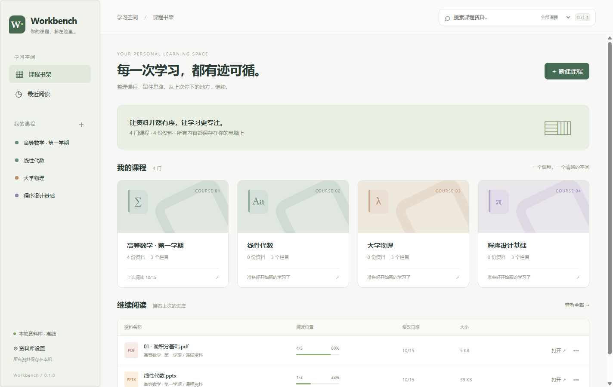
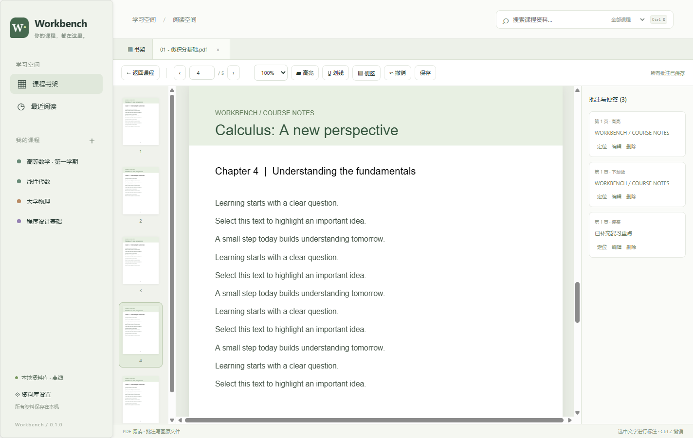

# Workbench

一个本机离线的 Windows 课程资料管理与阅读工具。把分散的课程资料放到清晰的课程书架中，随时从上次阅读的位置继续。

**当前版本：0.1.0，早期可用版本。** 本仓库包含源码、图标、测试、设计文档和开源许可声明，不包含个人课程文件、开发机配置、测试运行产物或安装包。当前请按下方步骤自行构建。



## 功能

- 创建课程，设置名称与封面颜色；每门课程固定包含「课程资料」「作业」「其他资料」。
- 文件与多级文件夹管理：导入、拖入、重命名、跨栏目移动、删除至 Windows 回收站。
- 按文件名搜索全部课程或当前课程；按名称、添加时间、修改时间或最近打开排序。
- 同步资料库目录变化，支持资源管理器定位和使用外部软件打开。
- 在 app 内阅读 PDF 与 PPT/PPTX，支持多个标签、缩略图、缩放和页码跳转。
- 自动记录每份文件的当前页码，列表显示「当前页 / 总页」；启动时进入书架。
- 选中文字高亮、加下划线、添加中文便签；支持编辑、删除、自动保存和会话内撤销。



## 使用前需要了解

**导入会把文件从原位置移动到资料库，只保留一份。** 文件夹导入保留子目录结构；重命名、移动和删除操作也会作用于实际磁盘文件。请选择专用的资料库目录，重要资料建议先备份。

PDF 批注作为标准注释写回原 PDF。PPTX 的选字高亮、下划线会作为图形标记写回幻灯片，文字便签写为原生 PowerPoint 评论；不修改原文字的字体高亮属性。保存发现文件被其他软件修改时，会拒绝覆盖，并允许保留待保存批注重试或明确放弃后重新打开。

PPT 阅读和写回需要本机安装 **Microsoft PowerPoint**，使用静态页面预览，不保留放映动画。旧版 `.ppt` 可阅读，批注需要先另存为 `.pptx`。扫描 PDF 和图片文字不提供 OCR，无法直接选字高亮。复杂公式、旋转文字、特殊字体及受保护课件仍需实际资料验收。

第一版没有账号、云同步、遥测、全文搜索、深色模式和作业提醒。应用运行时阻断外部网络；首次安装开发依赖和打包工具仍需要联网。

## 开发和启动

要求：Windows 10/11 x64、Node.js 24+ 和 npm。只有 PPT 功能需要 Microsoft PowerPoint；使用 Python 辅助测试需要 Python 3。已提供应用图标，常规构建不需要 Pillow。

克隆仓库并进入仓库目录后执行：

```powershell
git clone https://github.com/yu2660/Workbench.git
cd Workbench
npm ci --ignore-scripts
node node_modules/electron/install.js
npm start
```

安装时先禁用生命周期脚本，随后单独执行 Electron 官方运行时下载脚本。若网络环境导致下载失败，可检查代理设置；`scripts/download-electron.py` 是仅针对当前锁定版本及 Windows x64 的分段下载辅助工具，会验证 npm 包内的 SHA-256。它不是应用运行依赖，升级 Electron 后需要重新核实其适用性。

## 构建 Windows 安装包

```powershell
npm run licenses
npm run dist
```

生成结果位于 `dist/`：

- `Workbench Setup 0.1.0.exe`：NSIS 安装包，支持选择安装位置和创建桌面快捷方式。
- `win-unpacked/Workbench.exe`：解包后的程序；请保留整个 `win-unpacked` 文件夹一起使用。

程序运行不需要额外安装 Node.js。安装包当前未进行代码签名，Windows 可能显示未知发布者。代码仓库不保存构建缓存或安装文件；尚未发布 GitHub Release。

## 验证

核心测试：

```powershell
npm test
```

下列测试需要正常的 Windows 桌面登录会话和 Microsoft PowerPoint；它们会生成隔离的演示资料、临时目录和窗口。涉及删除的测试只对生成的测试文件调用回收站。补充测试依赖前一步生成的结果，请按顺序运行：

```powershell
node tests/powerpoint.cjs
npm run test:e2e
node tests/operations.cjs
python tests/inspect_pptx.py
node tests/conflict.cjs
node tests/cjk.cjs
npm run licenses
npm run dist
node tests/packaged.cjs
node scripts/verify-release.cjs
```

已验证的初版包含 16 项核心测试、15 项主要桌面流程和 7 项补充操作流程，并实测中文 PDF/PPTX、写回冲突保护和打包后的程序。详情与未覆盖范围见 [验证记录](docs/VALIDATION.md)。`npm audit` 在 2026-10-15 的记录为 0 项已知漏洞，后续依赖公告可能变化；这不等于完整安全认证。

## 数据、隐私和备份

- 资料保存在首次选择的本地资料库中，阅读位置与课程索引位于其 `.workbench/library.json`。
- 批注写在原文件内；应用设置与可重新生成的 PPT 预览缓存位于 Electron 的用户数据目录，通常在 `%APPDATA%` 下。
- 备份整个资料库可保留资料、课程索引和阅读位置。第一版没有崩溃恢复；PDF 重写可能影响数字签名，加密或只读文件可能无法批注。
- 本仓库演示截图只使用生成的示例资料，并隐藏本机目录。测试输出、私人资料库、账户凭据、日志及机器设置均不纳入版本控制。
- 提交问题或截图时，请先移除课程文件内容、姓名、账号和本机路径；不要上传真实课程文件或未脱敏日志。

## 开源组件和许可证

本项目应用代码使用 [MIT License](LICENSE)。实际复用的主要组件为：

| 组件 | 用途 | 许可证 |
|---|---|---|
| [PDF.js](https://github.com/mozilla/pdf.js) | PDF 渲染、文字选择与缩略图 | Apache-2.0 |
| [pdf-lib](https://github.com/Hopding/pdf-lib) | PDF 标准注释写回 | MIT |
| [Electron](https://github.com/electron/electron) | 桌面窗口、系统文件操作和权限隔离 | MIT，附 Chromium 第三方声明 |

调研参考过 Zotero、Koodo Reader 和 Sioyek，未复制这些项目的代码或素材。第三方包有各自的版权和许可；请一并保留 [第三方声明](THIRD_PARTY_NOTICES.md) 与 [许可证副本](licenses/)。构建会将这些声明、Electron 许可证和 Chromium 第三方声明随程序提供。

## 更多文档

- [设计与行为](docs/DESIGN.md)
- [GitHub 调研与选型](docs/RESEARCH.md)
- [安全检查](docs/SECURITY.md)
- [验证记录与已知限制](docs/VALIDATION.md)
- [公开仓库内容与隐私检查](docs/PUBLICATION.md)
